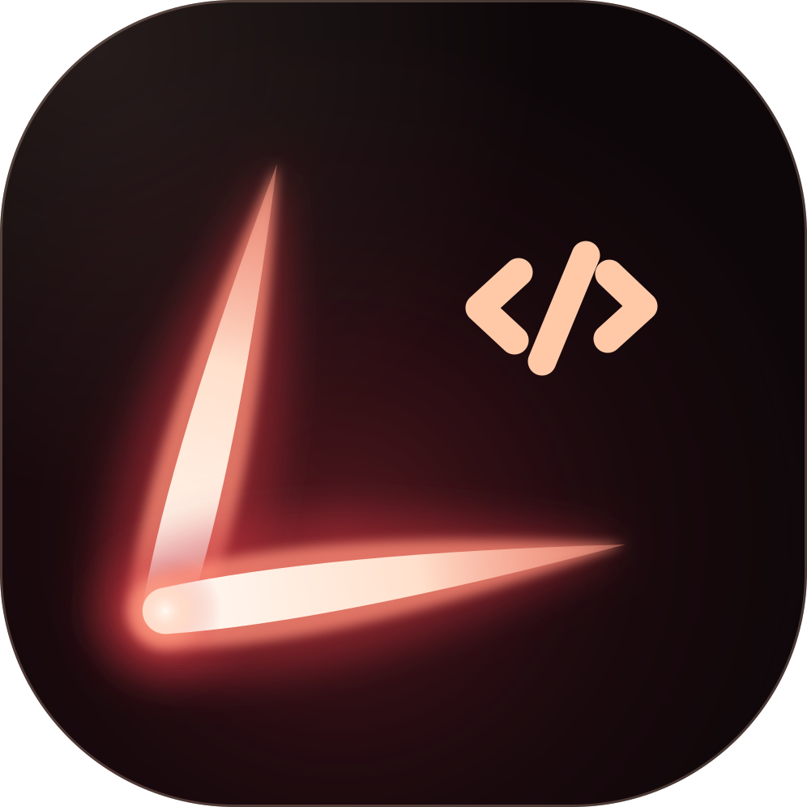

# Looma (backend)

Looma shows what changed in your code in plain words, so people who don't read code can
follow it. It runs on your own computer: it reads your projects' git history, explains changes
with the AI you choose, writes knowledge-transfer guides for new team members, and can record
what AI coding tools (Claude Code, Codex, Antigravity) changed and why.

This repo is the backend: a Python command line tool and local web server (FastAPI) that also
serves the dashboard page. The page's source is in its own repo,
[DevDash-FE](https://github.com/VardaanShukla/DevDash-FE); a built copy comes with this
package, so you don't need Node to use Looma.

Looma was called Looma until November 2026. Only the name changed: the command is still
`looma` (`looma` works too once installed from this version), your data stays in `~/.looma`,
the `LOOMA_*` settings and the `/api` addresses are the same, and the repos keep their names.

## What it does

- **Home**: a dashboard of widgets you arrange: the project and branch, today's AI work, the
  size of this branch, the latest AI prompts, changed files, the latest commit, activity,
  branches and commits.
- **This branch, Branch flow and Project map**: what the checked-out branch changed compared
  with its base (like a pull request), how branches split off and merge, and the project's
  parts with which part uses which.
- **AI changes**: every change your AI coding tool made, grouped by the request behind it,
  with what to check, and a way to undo one change.
- **Changes and Commits**: every changed file and function, before and after, explained in
  plain words on request (what it does, what it improves, what it costs), and the project's
  open pull requests on GitHub or AWS CodeCommit.
- **Summary**: the whole project on one page, read from its files and history: what it is,
  what it's built with, its parts, how to run it and who works on it.
- **KT (knowledge transfer)**, in two kinds:
  - **Brief KT**: a short guide written with one AI request in about a minute: what to install,
    setup steps with commands, how to run and use it, settings to fill in, the major functions
    and the project's own screenshots. Downloads as a PDF.
  - **Detailed KT**: the project explained for someone who has never coded: a map of its parts,
    the files to read in order, how things flow (step by step, file by file), where data lives
    (database tables, settings, browser storage), its commands and web addresses, a glossary,
    things to be careful with, and every file with what it does, what it uses and what uses it.
    The facts are read from the code; the AI writes the words, and anything it names that the
    code doesn't bear out (a file, a part, a step not linked by a real import) is left out.
    Downloads as a PDF or as one interactive page (search, map, jump between files) that works
    offline.
- **Ask**: questions about the project in plain words, answered from the KT notes and the code
  of the files the question is about. It explains; it never changes code.
- **Your choice of AI**: Claude (the default, using your own Claude Code login), ChatGPT Codex,
  Antigravity, your own server (paste the curl command that reaches it), or a local model with
  Ollama. For Ollama, Looma reads your CPU, memory and GPU and suggests a model that fits.
- **Projects without git** can be added too: Summary, KT, Ask and the project map work from the
  folder's files; branches, changes, commits, pull requests and AI recording need git and stay
  off until you run `git init` in the folder.
- **Private by design**: a username and password keep the dashboard to you, the server listens
  on 127.0.0.1 only, and everything stays on your computer in SQLite under `~/.looma`. The
  only things sent anywhere are what you ask the AI you picked to explain.

## Install and run

Looma needs Python 3.10 or newer, git, and [pipx](https://pipx.pypa.io) (which installs
Python apps in their own space). Node is not needed: the dashboard page comes built in.

### The easy way: the installer script

`scripts/looma.sh` (Linux and macOS) and `scripts/looma.bat` (Windows; it runs
`looma.ps1`) install, repair, uninstall or start Looma from one menu. Clone DevDash-FE
next to this repo if you want the page built from its source; otherwise the page already
built in here is used, and Node isn't needed:

```
DevDash-BE/
  scripts/
    looma.sh     Linux and macOS
    looma.bat    Windows (double-click it)
    looma.ps1
    build_ui.py    builds the page (the scripts run it for you)
DevDash-FE/        optional, next to DevDash-BE
```

Linux and macOS: double-click `scripts/looma.sh` (it opens a terminal), or run
`bash scripts/looma.sh` in DevDash-BE. Windows: double-click `scripts\looma.bat`. To
build the page from a DevDash-FE somewhere else, set `LOOMA_FE` to its folder first.

| Option | What it does |
|---|---|
| **1 Install** | Checks for Python 3.10+, pipx and (when DevDash-FE is there) Node 18+, and asks before installing any that are missing (`sudo apt`/`dnf`/`pacman`/`zypper` or `brew` on Linux and macOS, `winget` on Windows; your password goes to those, never to the script). Builds the page, installs Looma with pipx, asks where your projects are and runs `looma init` on that folder, then offers to start it. If Looma is already installed, it says to use Repair. |
| **2 Repair** | The same, but reinstalls over whatever is there (`pipx install --force`), stopping a running Looma first. Your data in `~/.looma` stays. Use it after pulling new code. |
| **3 Uninstall** | After you type `DELETE`: takes Looma's hooks out of every project and AI tool (`looma remove-hooks`), uninstalls Looma and **deletes `~/.looma`** (your Looma account, project list and recorded history). Your projects' files and git history, Ollama and its models are not touched. Back up `~/.looma` first if you may want it again (see "Uninstall Looma safely"). |
| **4 Start** | Runs `looma serve` and opens http://127.0.0.1:8765. Keep the window open while you use it; Ctrl+C stops it. |

The install is a regular one, not editable: after changing the code, run Repair. Projects
don't each need `looma init`: the folder you give at install is searched for git repos,
and you pick the ones to track under Add project.

The steps below do the same by hand.

### Windows

1. **Check what you have.** In Command Prompt or PowerShell:

   ```bat
   py --version
   git --version
   ```

   If `py` isn't found or says older than 3.10, install [Python](https://www.python.org/downloads/)
   (tick "Add python.exe to PATH"). If `git` isn't found, install
   [Git for Windows](https://git-scm.com/download/win): Looma's git hook runs in its `sh`.
2. **Install pipx** and put its folder on your PATH:

   ```bat
   py -m pip install --user pipx
   py -m pipx ensurepath
   ```

3. **Install Looma**, from GitHub or from a folder you cloned it into:

   ```bat
   py -m pipx install --force git+https://github.com/VardaanShukla/DevDash-BE.git
   py -m pipx install --force C:\path\to\DevDash-BE
   ```

4. **Close every terminal and open a new one** (so it sees the new PATH), then start it:

   ```bat
   looma serve
   ```

5. Open http://127.0.0.1:8765 in your browser on the same computer.

### Linux

1. **Check what you have:** `python3 --version` (3.10 or newer) and `git --version`.
   Install what's missing with your package manager, e.g. `sudo apt install python3 python3-venv git pipx`.
2. **Install pipx**, if your package manager didn't: `python3 -m pip install --user pipx`, then
   `python3 -m pipx ensurepath`.
3. **Install Looma:**

   ```sh
   pipx install --force git+https://github.com/VardaanShukla/DevDash-BE.git
   # or from a clone:
   pipx install --force /path/to/DevDash-BE
   ```

4. **Open a new terminal** and run `looma serve`.
5. Open http://127.0.0.1:8765.

### macOS

1. **Check what you have:** `python3 --version` and `git --version`. Missing ones come from
   [python.org](https://www.python.org/downloads/) or `brew install python git`; running
   `git --version` the first time also offers Apple's command line tools, which include git.
2. **Install pipx:** `brew install pipx` (or `python3 -m pip install --user pipx`), then `pipx ensurepath`.
3. **Install Looma:** `pipx install --force git+https://github.com/VardaanShukla/DevDash-BE.git`
   (or `pipx install --force /path/to/DevDash-BE` from a clone).
4. **Open a new terminal** and run `looma serve`.
5. Open http://127.0.0.1:8765.

### First run

The first visit asks you to pick a username and password, then to add a project: the path of
any git folder on your computer, typed or pasted any way (`C:\Users\me\App`, `"C:\Users\me\App"`
from Windows' "Copy as path", `~/App`, `$HOME/App` or `%USERPROFILE%\App`). A project with no
readme, or nothing committed yet, works too. To pick from a list instead, point Looma at
the folder that holds your projects once: `looma init ~/Projects` remembers it, adds nothing
and changes nothing in them, and Add project then lists the projects inside.

Optional: install [Claude Code](https://claude.com/claude-code) (or Codex, Ollama or
Antigravity) and sign in for the plain-English explanations, and pick your AI coding tool when
adding a project to record each request it worked on (see below).

### Update to the latest version

Run `scripts/looma.sh` (Windows: `scripts\looma.bat`) and choose **Repair**, or run the same install command again:
`pipx install --force <GitHub URL or folder>` (Windows: `py -m pipx install --force …`). Then stop `looma serve` (Ctrl+C) and start it
again: it points the hooks at the new install by itself.

### If something goes wrong

- **`looma` isn't found.** Open a new terminal first. Still not found: run `pipx ensurepath`
  (Windows: `py -m pipx ensurepath`) and open another one. Or run it by its full path:
  `%USERPROFILE%\.local\bin\looma.exe serve` in Command Prompt,
  `& "$env:USERPROFILE\.local\bin\looma.exe" serve` in PowerShell, or
  `~/.local/bin/looma serve` on Linux and macOS. `python -m looma serve` also works from
  the environment it's installed in.
- **You'd rather use a virtual environment** (venv or conda) than pipx: activate it, run
  `pip install -e .` in the DevDash-BE folder, then `looma serve`. The command then works
  only while that environment is active, and the hooks Looma adds call that environment's
  Python.
- **Hooks point at a deleted environment.** If you delete that environment (or move the
  install) without uninstalling Looma first, git commits still work, but Claude Code reports
  a failing hook. Install Looma again and start `looma serve` once: it points every hook at
  the new install. Or remove them as in "Uninstall Looma safely".
- **A prompt is missing from AI changes.** Settings → Recording shows when each hook last ran
  and any hook errors, with the log files' paths. Only tools that run Looma's hooks are
  recorded: Claude Code (in a terminal, an editor extension or the desktop app's Code tab),
  Codex and Antigravity. Claude's Cowork mode and plain chats don't run them.

Projects can live anywhere and can move. A project that is moved, renamed or cloned again
somewhere else keeps its history: add the new folder (or just commit in it, if an AI tool is
connected) and Looma finds it is the same project, as long as the old folder is gone.

### Working on the page

The page's source is in its own repo, [DevDash-FE](https://github.com/VardaanShukla/DevDash-FE).
To work on it with live reload, keep `looma serve` running and start the UI's dev server
(`npm install` then `npm run dev` in DevDash-FE), which serves the page on
http://localhost:5173 and forwards `/api` to the API. To ship a change, build it into this
package and commit `src/looma/web`:

```sh
python scripts/build_ui.py ../DevDash-FE
```

## Track a repo

```sh
looma init ~/Projects/SomeRepo
```

This only registers the repo. Nothing is installed: your own commits are already in git.

## See what a branch changed

```sh
looma serve              # page and API on http://127.0.0.1:8765, API docs at /docs
```

`GET /api/repos/{id}/compare` returns what the checked-out branch changed since it left
`main` (or `master`), the same set of changes a pull request would show:

- the commits, each marked `ai` when it has an AI co-author line
- each file with its status, line counts and diff lines
- the functions and classes each file's change touches, marked added, deleted or modified

Options: `base` and `head` pick other branches; `uncommitted=true` adds edits and new files
not committed yet, so you can see work in progress, even on `main` itself.
Lockfiles and build output are counted but their lines are left out.

Other endpoints:

- `GET /api/repos` (tracked repos) and `GET /api/repos/{id}/branches`
- `POST /api/repos` with `{"path": "~/Projects/App", "ai": "claude" | null}` adds a project,
  the same as `looma init` (plus `looma connect claude` when `ai` is `"claude"`)
- `DELETE /api/repos/{id}` (with a `{}` JSON body) stops tracking a project: its files and
  git history stay, Looma's git hook comes out, and what it recorded for it is deleted
- `PUT /api/repos/{id}/ai` with `{"ai": "claude" | null}` connects or disconnects Claude
- `GET /api/repos/{id}/setup` lists the setup steps and which are done
- `GET /api/ai-tools` lists the AI tools Looma can record
- `GET /api/repos/{id}/state` is a fingerprint of branches, commits and (with
  `?uncommitted=true`) edits; the UI polls it and reloads only when it changes
- `GET /api/repos/{id}/flow` lists the newest commits across all branches with their
  parents and branch names, for drawing how branches fork and merge
- `GET /api/repos/{id}/map?head=branch` groups the branch's committed files into parts
  (folders), with each part's languages, a plain-words role guessed from its name, and
  which parts import code from which (JS, TS and Python imports of the project's own files)
- `GET /api/repos/{id}/functions?path=file` lists each function, method or type the branch
  changed in one file, before and after, with what differs: inputs, calls, decisions
  (ifs, loops, catches), size, its docstring or comment, and where else it is used.
  Python is read with its own parser; JS, TS and other brace languages with patterns
- `GET /api/repos/{id}/summary?head=branch` describes the whole project from its files and
  history: readme, package files, well-known tools it uses, commands, parts, people, activity
- `POST /api/repos/{id}/explain/function` (`{"path", "name"}`) and
  `POST /api/repos/{id}/explain/project` ask Claude Code for a plain-English explanation:
  what a function does, what the change improves and what it costs, or what the project is
  and how it works. Looma runs your installed `claude -p` in an empty folder with tools
  off, so it uses your Claude login and needs no API key. It asks Haiku, the small and
  cheap model, with a short system prompt of its own; set `LOOMA_CLAUDE_MODEL` (such as
  `sonnet`) for another. Answers are saved and reused. A 424 means Claude Code isn't signed in.
  `GET /api/ai` says whether `claude` is installed and signed in, and which model it uses
- `POST /api/ai/sign-in` signs in to Claude Code from the page: it runs `claude auth login`,
  which opens the sign-in page in the browser, and returns that page's address.
  `POST /api/ai/sign-in/code` (`{"code"}`) passes on the code the page shows when it can't
  finish by itself; `GET /api/ai/sign-in` says whether it's waiting, signed in or failed
- `GET /api/repos/{id}/kt/guide` and `POST /api/repos/{id}/kt/guide` read or write the Brief KT;
  `GET /api/repos/{id}/kt/image?path=` serves one of the project's own pictures for it
- `GET /api/repos/{id}/kt/detail?head=&worktree=` is the Detailed KT: parts, files with what
  each uses and what uses it, a reading path, data, routes and commands read from the code,
  with the AI's words once written. `worktree=true` reads the working folder, including
  changes not committed yet (the default when there are some). `POST /api/repos/{id}/kt/detail`
  (`{"head", "worktree", "fresh"}`) asks the AI for the words, from the notes on each file that
  `POST /api/repos/{id}/explain/file` (`{"path", "head", "fresh", "worktree"}`) writes
- `POST /api/repos/{id}/ask` (`{"question", "history", "head"}`) answers a question about the
  project in plain words
- `GET /api/home` lists every project at a glance: its branch, how many commits it is ahead
  of the base, files not committed, the latest commit, commits this week and branch count
- `GET /api/digest?day=YYYY-MM-DD` (today when left out) is the daily digest: what Claude
  changed that day, prompt by prompt and newest first, with the files and functions each
  prompt touched, whether it's committed yet, and how much you changed yourself. Plain rules
  flag changes worth a careful look: sign-in or permissions, payments, database structure,
  removed tests and anything that looks like a key or password; setup files, deleted files
  and very big changes are flagged as worth knowing. Only projects connected to Claude are
  recorded, so only they appear
- `POST /api/digest/undo` (`{"change": "<a digest change's id>"}`) undoes one of Claude's
  changes in your files by applying its recorded diffs in reverse with `git apply`: every
  file or none, and nothing is committed, so the undo is an ordinary change to review and
  commit. A 409 means a file changed since and the change no longer fits; nothing is
  touched then. `POST /api/digest/put-back` reapplies an undone change
  The day's totals leave out undone changes (`undone` counts them) and count a prompt
  that edited several projects once; `watched_files` counts files a prompt changed through
  a shell command rather than its edit tool, which may include your own edits made meanwhile
- `GET /api/recording/health` says whether recording works: when each hook last ran, recent
  errors, and `problems` in plain sentences (hooks missing or naming an old install, prompts
  whose end never arrived). `POST /api/recording/repair` reinstalls the hooks
- `POST /api/repos/{id}/sync` runs `git fetch --all --prune` so merges and branches
  deleted on GitHub show up

The API listens on 127.0.0.1 only, answers only requests addressed to localhost, and
accepts changes only as JSON from no page or the Looma UI. The full contract is at
`/openapi.json`.

### Username and password

The first time the dashboard opens it asks you to pick a username and a password (8
characters or more). Usernames ignore case. A password set before usernames existed keeps
the username of its first sign-in.
After that every route except the ones below needs a signed-in browser, which holds a
random token in an HttpOnly cookie for 30 days. The password is stored as a scrypt hash;
five wrong tries in a minute pause signing in for that minute.

- `GET /api/auth` says whether a password is set and whether this browser is signed in
- `POST /api/auth/login` (`{"username", "password"}`) signs in; `POST /api/auth/logout` signs out
- `PUT /api/auth/password` (`{"username", "password", "current"}`) sets the first username
  and password, or changes them from a signed-in browser; every other browser is signed out

Forgot it? `looma password` in a terminal sets a new password (and username, if you type
one) without the old one.

Function names come from git's own function detection, extended to JavaScript and
TypeScript. Methods inside a class in JS or TS are reported under the class.

## Optional: record your AI tool's changes

```sh
looma connect claude ~/Projects/SomeRepo      # start (or codex, or antigravity)
looma disconnect claude ~/Projects/SomeRepo   # stop; recorded history is kept
```

A project records one tool at a time, and needs git. For Claude Code, `connect claude` installs:

- a git `post-commit` hook in that repo (added to any existing shell hook, not replacing it)
- Claude Code hooks in your user settings, `~/.claude/settings.json`
  (`UserPromptSubmit`, `PreToolUse`, `PostToolUse` for Bash, `Stop`, `SessionEnd`). Nothing
  is added to the repo itself.

The Claude hooks run in every Claude Code session, wherever you start it: inside the repo,
or in a parent folder holding several repos. An edit is recorded only when the edited file
is inside a connected repo. A session started outside your connected repos that edits
nothing in one leaves no trace. Restart any Claude Code session that is already open.

## Claude app chats

Edits made from a Claude app chat reach your files without going through Claude Code,
so the hooks can't see them. Looma records them from git instead:

1. Run `looma instructions` and paste its text into the Claude project's instructions.
2. Claude then writes your request to `.looma/prompt.md` before each commit and adds
   a `Co-Authored-By: Claude` line to the message.
3. The post-commit hook stores that request with the commit's diff as an AI change and
   clears the file. `.looma/` is listed in `.git/info/exclude`, so it is never pushed.

A commit with an AI co-author line but no prompt file is still recorded as AI, without a
prompt. Uncommitted app edits are not visible until they are committed.

## See what was recorded

```sh
looma turns            # latest prompts that changed files, and the commit they landed in
looma turns --all      # include prompts that changed nothing
```

Data lives in `~/.looma/looma.db` (set `LOOMA_HOME` to move it).
Hook errors never interrupt Claude Code or git; they go to `~/.looma/errors.log`.
Every hook call is logged (tool and file, never the prompt) to `~/.looma/hooks.log`.

## How a change is recorded

1. `UserPromptSubmit` starts a turn and saves the prompt and branch.
2. `PreToolUse` saves each file's content just before Claude first edits it in that turn.
3. `PostToolUse` notes the files each shell command changed, so they still count if you
   press Esc (an interrupted prompt gets no `Stop`).
4. `Stop` (or `SessionEnd`, when you quit or `/clear` mid-prompt) diffs those files against
   their saved content, plus any other file that changed while the prompt ran. Your own
   edits made before the turn are left out, and a file another Claude session changed with
   its own edit tool is left to that session, so nothing is counted twice.
5. `post-commit` links the turn's changes to the commit. Files in the commit that Claude
   didn't touch are recorded as human changes.

Lockfiles, `node_modules`, build output and files over 1 MB are skipped.

## Uninstall Looma safely

Looma never changes your project files or their git history. What it adds, and takes out
again when a project stops recording:

- In each project that records an AI tool: two lines at the end of `.git/hooks/post-commit`
  (a `# looma: records commits` line and the command under it). Anything else in that
  hook is yours and stays; the file is deleted only if Looma made it. Also a
  `/.looma/` line in `.git/info/exclude`, so a Claude app chat's notes there stay out of
  git. That line is harmless and stays.
- For the AI tool a project records, while any project records it:
  - Claude Code: five entries in `~/.claude/settings.json`, under `UserPromptSubmit`,
    `PreToolUse`, `PostToolUse`, `Stop` and `SessionEnd`, each running `… -m looma record …`. Your other settings and
    hooks stay.
  - Codex: `UserPromptSubmit`, `PreToolUse` and `Stop` in `~/.codex/hooks.json` (the file goes if only Looma's were in it).
  - Antigravity: a `looma` entry in `~/.gemini/config/hooks.json`.
- Its own data in `~/.looma` (`%USERPROFILE%\.looma` on Windows): the projects list,
  what was recorded, settings and the dashboard password.

Nothing starts Looma by itself: it runs only while `looma serve` does.

**The quick way:** run `scripts/looma.sh` (Windows: `scripts\looma.bat`) and choose **3 Uninstall**. It does steps 1 to 3 below and deletes `~/.looma`
without a backup, so make one first (step 4) if you may want the history again.

By hand:

1. **Stop recording in every project.** One command does them all:

   ```sh
   looma remove-hooks
   ```

   It takes Looma's lines out of every recording project's git hook and Looma's hooks out
   of Claude Code, Codex and Antigravity. Or, one project at a time: in the dashboard choose
   "Remove project from Looma" (or "Stop recording AI changes"), or run:

   ```sh
   looma disconnect claude /path/to/project
   ```

   This takes Looma's lines out of that project's git hook, and once no project records
   an AI tool any more, its hooks out of `~/.claude`, `~/.codex` or `~/.gemini`. Do this
   first: after uninstalling, the `looma` command isn't there to do it.
2. **Stop Looma:** Ctrl+C in the terminal running `looma serve`.
3. **Uninstall it:**

   ```sh
   pipx uninstall looma
   ```

   or, if you installed it into a virtual environment, activate it and run
   `pip uninstall looma`. On Windows: `py -m pipx uninstall looma`.
4. **Optional, and permanent: delete Looma's data.** Keep a copy first. Linux and macOS:

   ```sh
   cd ~ && tar -czf looma-backup.tar.gz .looma
   rm -rf ~/.looma
   ```

   Windows (PowerShell):

   ```powershell
   Compress-Archive -Path "$env:USERPROFILE\.looma" -DestinationPath "$env:USERPROFILE\looma-backup.zip"
   Remove-Item -Recurse -Force "$env:USERPROFILE\.looma"
   ```

   Windows (Command Prompt):

   ```bat
   tar -czf "%USERPROFILE%\looma-backup.tar.gz" -C "%USERPROFILE%" .looma
   rmdir /s /q "%USERPROFILE%\.looma"
   ```

If you uninstalled before step 1, the hooks are left calling a Looma that isn't there. Git
commits still work (the hook ends in `|| true`), but Claude Code reports a failing hook. Take
them out by hand: delete Looma's two lines from each project's `.git/hooks/post-commit`,
and in `~/.claude/settings.json` (and `~/.codex/hooks.json`) delete each hook whose command
contains `looma record`, leaving the others. Or install Looma again, do step 1, and
uninstall.

## Settings from the environment

All optional.

| Variable | What it does |
|---|---|
| `LOOMA_HOME` | Where Looma keeps its data (default `~/.looma`) |
| `LOOMA_CLAUDE_MODEL` | The Claude model for explanations when Settings doesn't pick one (default `haiku`) |
| `LOOMA_EXPLAIN_REVIEW` | `0` turns off the second pass that checks a function's pros and cons |
| `OLLAMA_HOST` | Where Ollama runs (default `127.0.0.1:11434`) |
| `CLAUDE_CONFIG_DIR`, `CODEX_HOME`, `LOOMA_ANTIGRAVITY_CONFIG` | Where Claude Code, Codex and Antigravity keep their settings, for their hooks |
| `LOOMA_GITHUB_CLIENT_ID`, `LOOMA_GITHUB_APP` | A GitHub App to sign in with for pull requests (you can also paste a token in Settings) |
| `LOOMA_GITHUB_API`, `LOOMA_GITHUB_URL` | Another GitHub address, such as GitHub Enterprise |
| `AWS_CONFIG_FILE`, `AWS_SHARED_CREDENTIALS_FILE` | Where the AWS profiles for CodeCommit are |
| `LOOMA_FE` | For the installer scripts: a DevDash-FE folder somewhere other than next to this repo |

## Develop and test

```sh
python3 -m venv .venv
. .venv/bin/activate            # Windows: .venv\Scripts\activate
pip install -e '.[dev]'
python -m pytest
looma serve                   # http://127.0.0.1:8765, API docs at /docs
```

A few tests in `tests/test_providers.py` look at the computer they run on (they expect no GPU and
no Ollama service running) and fail on a machine that has them.

To change the page, see "Working on the page" above; `python scripts/build_ui.py ../DevDash-FE`
rebuilds `src/looma/web`, which is committed so installs need no Node.

## How the code is laid out

- `src/looma/cli.py`: the `looma` command (`init`, `connect`, `disconnect`, `serve`,
  `turns`, `instructions`, `remove-hooks`, `password`, and `record`, which the hooks call).
- `src/looma/api/app.py`: the local web server and the shape of everything it sends.
- `src/looma/capture/`: recording AI tools' changes: the hooks (`install.py`), what each hook
  event records (`record.py`), commits made outside the hooks (`scan.py`) and the Claude app
  chats' prompt file (`inbox.py`).
- `src/looma/store/`: the SQLite database and its migrations.
- Reading git: `git.py`, `compare.py` (what a branch changed), `functions.py` (which functions
  changed), `flow.py` (branch flow), `home.py`.
- Reading a project: `projectmap.py` (its parts and imports), `summary.py` (Summary and the KT's
  files), `filegraph.py` and `ktdoc.py` (the Detailed KT's facts and checks).
- The AI: `explain.py` (prompts, saved answers, Claude Code), `providers.py` (Codex, Ollama,
  Antigravity, your own server), `prompts.py`.
- `digest.py` and `undo.py`: AI changes by day, and undoing one. `github.py` and
  `codecommit.py`: pull requests. `auth.py`, `preferences.py`, `retention.py`, `paths.py`:
  sign-in, settings, cleaning up old data, where data lives.
- `src/looma/web/`: the built dashboard page. `scripts/`: the installers and `build_ui.py`.

## License

Looma is created by [Vardaan Shukla](https://github.com/VardaanShukla) and released under the [Apache License 2.0](LICENSE). Copies and forks must keep the [NOTICE](NOTICE) file with that credit.
